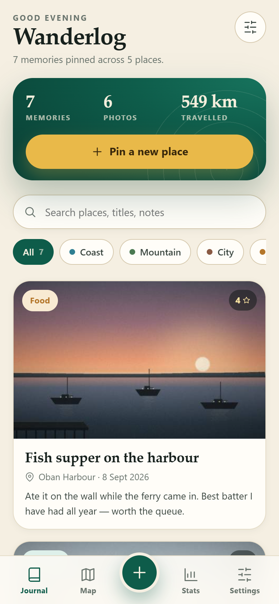
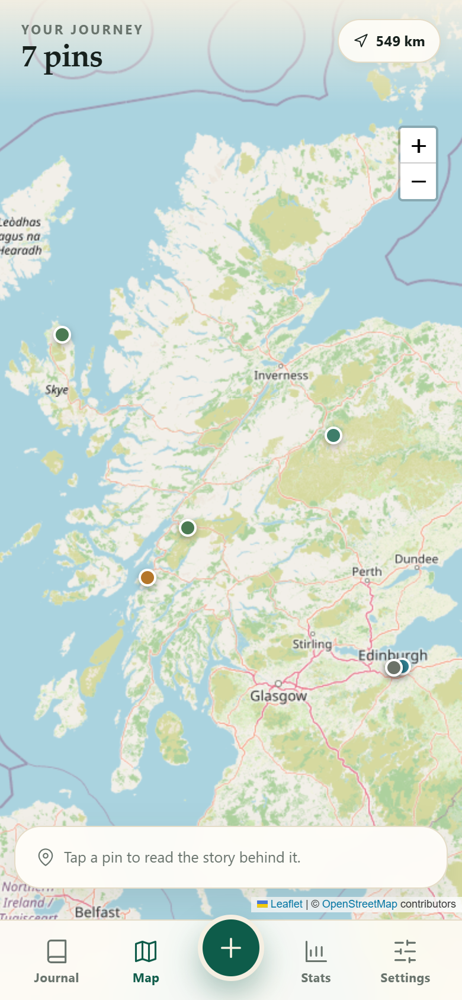
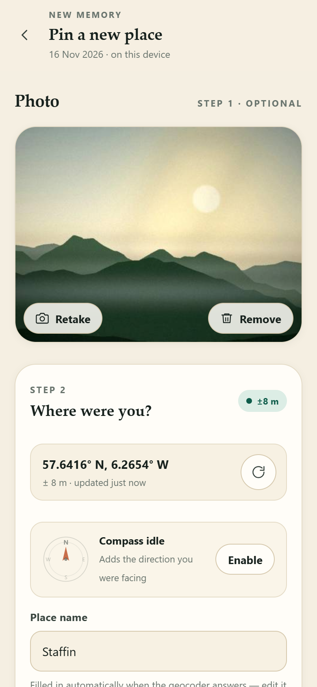
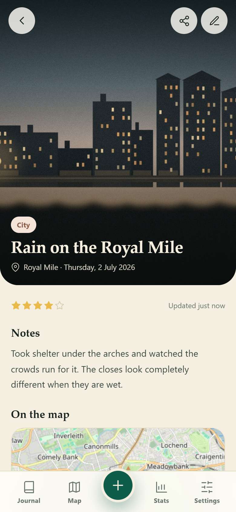
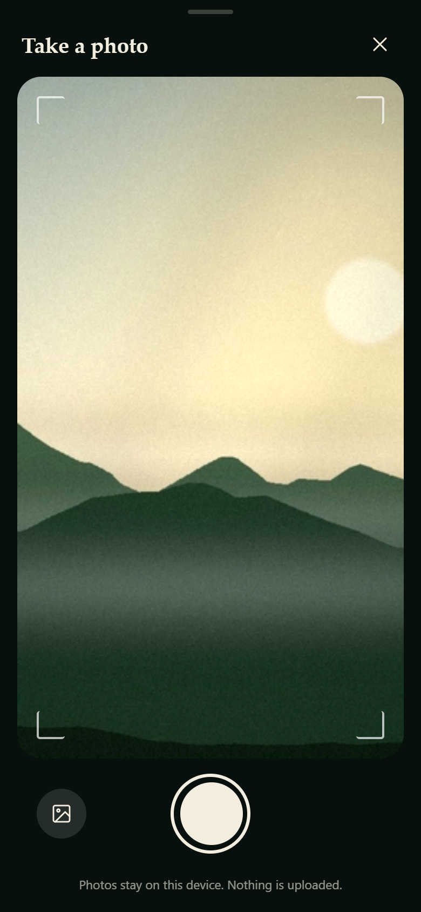
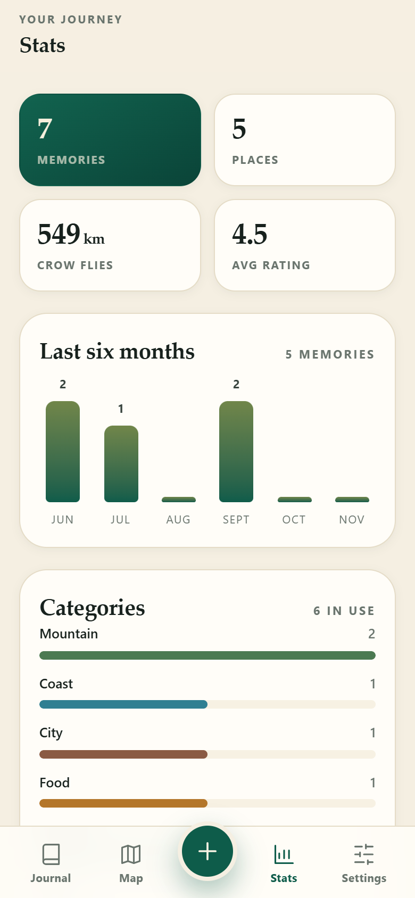
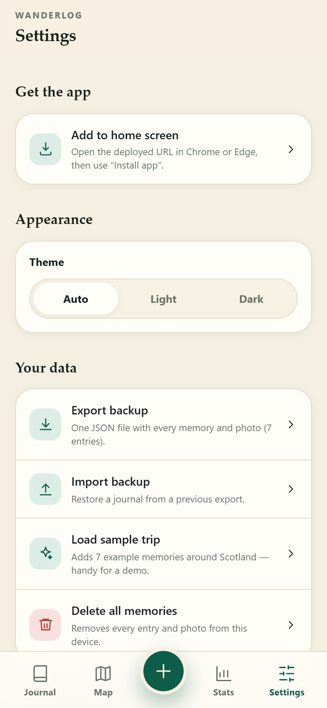
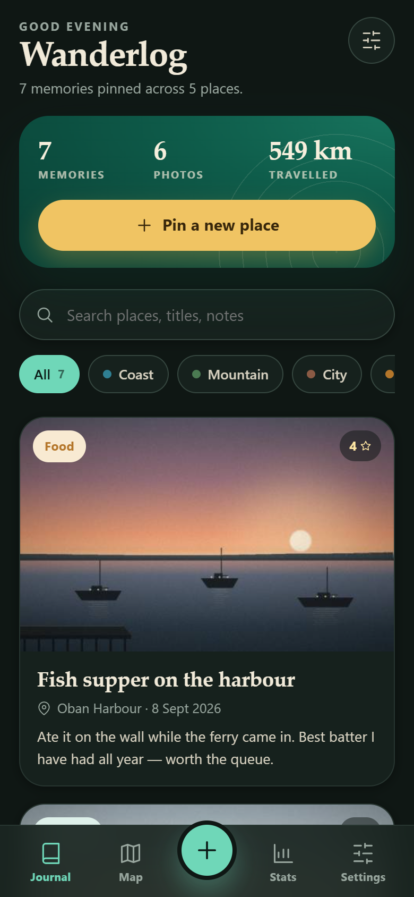

# Wanderlog — an offline-first travel journal PWA

> Pin the places you have been, keep a photo and a story, and watch the journey grow on a map.
> Everything is stored on the device: no account, no upload, no signal required.

<p align="center">
  
</p>

Wanderlog was built for **COMP10013 Dynamic Web Technologies — Coursework 1**. It is a React +
TypeScript progressive web app that uses two hardware APIs (Geolocation and Camera, plus the
compass and vibration APIs as extras), stores every memory in IndexedDB with full CRUD, and keeps
working offline through a Workbox service worker.

| Journal | Map | Capture |
| --- | --- | --- |
|  |  |  |

---

## Contents

- [Features](#features)
- [How the coursework requirements are met](#how-the-coursework-requirements-are-met)
- [Tech stack](#tech-stack)
- [Architecture](#architecture)
- [Getting started](#getting-started)
- [Using the app](#using-the-app)
- [Deployment](#deployment)
- [Project structure](#project-structure)
- [Data model](#data-model)
- [Testing](#testing)
- [Screenshots](#screenshots)
- [Credits](#credits)
- [Licence](#licence)

---

## Features

**Journal**

- Card list of memories ordered by the date visited, with category filter chips and full-text search
  across titles, notes and place names.
- An empty state that can seed a seven-place sample trip around Scotland (useful for a demo).

**Capture**

- Live camera preview (`navigator.mediaDevices.getUserMedia`) with a canvas shutter, front/rear
  switch, and automatic fallback to the OS camera app or the photo library.
- One-shot GPS fix through `navigator.geolocation.watchPosition`, with live accuracy feedback and a
  compass heading from the Device Orientation API.
- Reverse geocoding through Nominatim fills the place name automatically, is cached in IndexedDB,
  and fails gracefully back to "type it yourself".
- Title, notes (with a counter), category, five-star rating and visited date.

**Read, update, delete**

- Entry detail page with hero photo, notes, coordinates and an interactive map card.
- Edit reuses the same form, prefilled from IndexedDB.
- Delete is confirmed and removes the entry and its photo blobs in one transaction.
- Share through the Web Share API (including the image when the browser supports file sharing),
  with a clipboard fallback.

**Map and stats**

- Leaflet + OpenStreetMap view with category-coloured pins that open a detail sheet.
- Distance "as the crow flies" between consecutive memories, monthly activity chart, category
  breakdown and highest-rated list.

**PWA**

- Installable manifest, maskable icons, standalone display, iOS "Add to Home Screen" guidance.
- Workbox precache for the whole app shell, cache-first map tiles and a network-first geocoder
  cache, plus an in-app "new version available" prompt.
- Dark mode, reduced-motion support, visible focus rings, 44 px touch targets and safe-area insets.

**Data ownership**

- JSON export/import (photos embedded as data URLs) and a "delete everything" action.
- Storage usage shown from `navigator.storage.estimate()`.

---

## How the coursework requirements are met

| Requirement | Where it lives |
| --- | --- |
| Installable PWA / mobile app | `vite.config.ts` (manifest + Workbox), `src/App.tsx`, install UI in `src/features/settings/SettingsPage.tsx` |
| At least two device APIs | Geolocation: `src/hooks/useGeolocation.ts`; Camera: `src/hooks/useCamera.ts`. Extras: `useDeviceOrientation.ts` (compass), `src/lib/haptics.ts` (Vibration), `src/lib/share.ts` (Web Share) |
| On-device storage + CRUD | IndexedDB through Dexie: `src/lib/db.ts`, `src/lib/entries.repo.ts` |
| Persistence across restarts | IndexedDB stores entries and photo `Blob`s; confirmed by the reload test in [docs/USER-GUIDE.md](docs/USER-GUIDE.md) |
| Offline capability | Workbox service worker, precache manifest, runtime caches for tiles and geocoding |
| Original code | Component library, design system, hooks, generator scripts and tests written for this project |
| GitHub repository | This repository, with a README, CI workflow and more than one commit |
| Deployment | GitHub Pages workflow, plus Netlify/Vercel configuration |

---

## Tech stack

| Layer | Choice | Why |
| --- | --- | --- |
| UI | React 19 + TypeScript | Hooks and composable state; strict typing caught several API-shape mistakes |
| Build | Vite 7 | Fast dev server and a small production bundle with per-route code splitting |
| Storage | Dexie 4 (IndexedDB) | Reactive queries via `useLiveQuery`, indexes, and native `Blob` storage without base64 bloat |
| Map | Leaflet 1.9 + OpenStreetMap tiles | Small, dependency-light map with a runtime tile cache |
| PWA | `vite-plugin-pwa` (Workbox) | Generates the manifest and a precache service worker from the build |
| Tests | Vitest | Pure-function tests for geo maths, formatting, validation and stats |
| Icons | Hand-written SVG sprite | No icon dependency; every glyph inherits `currentColor` |

No UI framework, no CSS-in-JS, no state library: the app is roughly 4,000 lines of readable
TypeScript and CSS.

---

## Architecture

```
┌─────────────────────────────────────────────────────────────┐
│  Screens (React Router, hash routing)                       │
│  Journal · Capture · Entry · Map · Stats · Settings         │
└───────────────▲─────────────────────────────▲───────────────┘
                │ useState / useReducer-free  │
┌───────────────┴─────────────────────────────┴───────────────┐
│  Custom hooks                                               │
│  useGeolocation · useCamera · useDeviceOrientation          │
│  useInstallPrompt · useTheme · useObjectUrl · useOnline     │
└───────────────▲─────────────────────────────▲───────────────┘
                │                             │
┌───────────────┴───────────────┐ ┌───────────┴───────────────┐
│  Domain library (pure-ish)    │ │  Device + network APIs    │
│  entries.repo · db · geo      │ │  Geolocation · MediaDevices│
│  image · geocode · stats      │ │  DeviceOrientation · Share │
│  validation · exportImport    │ │  Vibration · Clipboard     │
└───────────────▲───────────────┘ └───────────────────────────┘
                │
┌───────────────┴─────────────────────────────────────────────┐
│  IndexedDB (Dexie): entries · places (geocode cache)        │
│  + Service worker caches: app shell · tiles · geocoding     │
└─────────────────────────────────────────────────────────────┘
```

Data flows one way: a screen calls a repository function, Dexie writes to IndexedDB, and every
`useLiveQuery` subscriber re-renders with the new data. There is no manual cache invalidation and
no global store.

A longer write-up lives in [docs/ARCHITECTURE.md](docs/ARCHITECTURE.md).

---

## Getting started

### Prerequisites

- **Node.js 20.19+** (developed on Node 24)
- **pnpm 9+** — `npm install -g pnpm`
- A modern browser. For the camera and geolocation APIs the page must run on `https://` **or**
  `http://localhost` (secure context).

### Install and run

```bash
git clone https://github.com/<your-github>/wanderlog.git
cd wanderlog
pnpm install
pnpm dev
```

Open <http://localhost:5173>. The dev server prints a LAN URL too, but hardware APIs on a phone
require HTTPS — see [docs/DEPLOYMENT.md](docs/DEPLOYMENT.md).

### Production build

```bash
pnpm build      # type-check, then build to dist/
pnpm preview    # serve dist/ on http://localhost:4173
```

The build is fully static: `dist/` can be dropped on any static host.

### Other scripts

| Script | What it does |
| --- | --- |
| `pnpm dev` | Vite dev server with HMR, exposed on the LAN |
| `pnpm build` | `tsc --noEmit` followed by `vite build` |
| `pnpm preview` | Serves the production build locally |
| `pnpm typecheck` | TypeScript only |
| `pnpm test` | Vitest unit tests |
| `pnpm test:watch` | Vitest in watch mode |

### Regenerating assets

The demo photography and the PWA icons are generated, not downloaded:

```bash
python tools/make_assets.py
```

It uses Pillow + numpy to paint six "travel poster" landscapes and the rounded compass icon.

---

## Using the app

1. **First run** — the journal is empty. Tap **Load a sample trip** to add seven memories around
   Scotland, or **Log a place** to start your own.
2. **Capture a memory** — tap the raised **+**, allow location, take or choose a photo, edit the
   auto-filled place name, add a title/notes/rating and save.
3. **Browse** — search or filter the journal; tap a card for the full story and map.
4. **Map** — every entry with coordinates appears as a coloured pin; tap one to open it.
5. **Settings** — theme, install prompt, JSON backup, sample data and "delete everything".

A step-by-step guide with screenshots is in [docs/USER-GUIDE.md](docs/USER-GUIDE.md).

---

## Deployment

The repository ships with three deployment paths:

- **GitHub Pages** — `.github/workflows/deploy.yml` runs tests, builds, and publishes `dist/` on
  every push to `main`. Enable *Settings → Pages → Source: GitHub Actions* once.
- **Netlify** — `netlify.toml` sets the build command and publish directory; drag-and-drop or connect
  the repository.
- **Vercel** — `vercel.json` does the same for `vercel deploy`.

Because `base` is `'./'` and routing is hash-based, the same build works from a sub-path
(`https://<user>.github.io/wanderlog/`) without further configuration.

Full instructions, including HTTPS-on-your-phone options, are in
[docs/DEPLOYMENT.md](docs/DEPLOYMENT.md).

## Android APK

The same build is also packaged as an installable Android app in [`android/`](android/README.md).
The APK bundles `dist/` inside the package and serves it to a WebView from `http://127.0.0.1`,
which is a secure first-party origin: IndexedDB, geolocation and the camera work without any
network, hosting or certificate.

```powershell
cd android
powershell -ExecutionPolicy Bypass -File .\build.ps1
# -> submission/Wanderlog.apk
```

Requires JDK 17 and Android SDK build-tools 34. The output is a signed ~1.3 MB APK
(`minSdk 23`, `targetSdk 34`).

---

## Project structure

```
wanderlog/
├── public/
│   ├── demo/                  six generated demo photos
│   └── icons/                 favicon + PWA icons
├── src/
│   ├── App.tsx                router, shell, providers
│   ├── main.tsx               React root
│   ├── components/            icons, header, nav, UI primitives
│   ├── features/
│   │   ├── journal/           list, cards, search
│   │   ├── capture/           form, camera sheet, location panel
│   │   ├── entry/             detail page
│   │   ├── map/               Leaflet map + lazy wrapper
│   │   ├── stats/             charts and metrics
│   │   └── settings/          install, theme, backup, storage
│   ├── hooks/                 device APIs and small utilities
│   ├── lib/                   IndexedDB, geo, images, formatting, export
│   ├── styles/                tokens, base, components, screens
│   └── types.ts               domain types
├── tests/                     Vitest unit tests
├── tools/make_assets.py       demo photo + icon generator
├── docs/                      architecture, user guide, deployment
└── vite.config.ts             build + PWA configuration
```

---

## Data model

```ts
interface Entry {
  id: string                 // UUID
  title: string
  notes: string
  category: 'coast' | 'mountain' | 'city' | 'food' | 'culture' | 'wildlife' | 'other'
  rating: number             // 0 = unrated, otherwise 1–5
  visitedAt: number          // epoch ms, used for ordering
  createdAt: number
  updatedAt: number
  place: { name: string; region?: string; country?: string }
  coords: { lat: number; lng: number; accuracy?: number; heading?: number } | null
  photo: {
    id: string
    blob: Blob               // 1600 px JPEG
    thumb: Blob              // 480 px JPEG for lists
    width: number
    height: number
    bytes: number
    source: 'camera' | 'library'
    capturedAt: number
  } | null
}
```

Dexie schema:

```ts
this.version(1).stores({
  entries: 'id, visitedAt, createdAt, category',
  places: 'key, fetchedAt',
})
```

Photos are re-encoded through a canvas before storage, which keeps a typical phone photo at
~250 kB instead of 4 MB and strips EXIF metadata (including GPS tags the user may not expect to be
duplicated).

---

## Testing

```bash
pnpm test
```

55 unit tests cover:

- great-circle distance, bearing, compass points and distance formatting;
- date/relative-time formatting, byte sizes, truncation and date-input round-trips;
- draft validation (required fields, length limits, rating range);
- journal summaries: counts, average rating, distance, monthly buckets and category breakdown.

`pnpm build` also runs `tsc --noEmit` with `strict`, `noUnusedLocals` and `noUnusedParameters`.

---

## Screenshots

| | |
| --- | --- |
|  |  |
|  |  |
|  |  |

---

## Credits

- Map tiles and reverse geocoding: © [OpenStreetMap](https://www.openstreetmap.org/copyright)
  contributors, geocoding by [Nominatim](https://nominatim.org/). Please respect the
  [tile usage policy](https://operations.osmfoundation.org/policies/tiles/) and the
  [Nominatim usage policy](https://operations.osmfoundation.org/policies/nominatim/) if you fork
  this project.
- Demo photography and icons are generated by `tools/make_assets.py` and are original work.
- Built with [React](https://react.dev/), [Vite](https://vite.dev/), [Dexie](https://dexie.org/),
  [Leaflet](https://leafletjs.com/) and [Workbox](https://developer.chrome.com/docs/workbox/).

## Licence

MIT © Guangpeng Shen. See [LICENSE](LICENSE).
