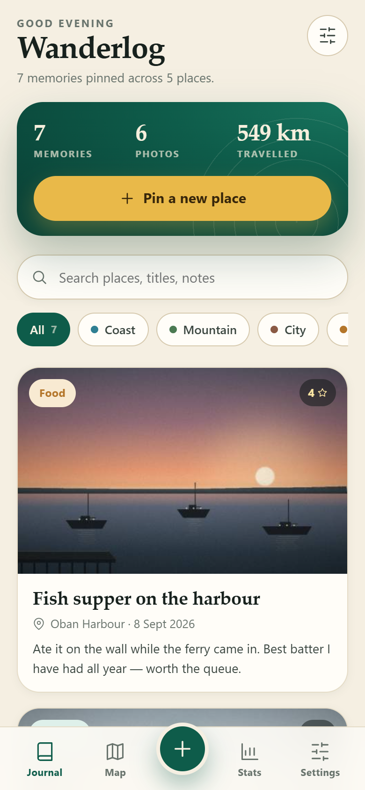
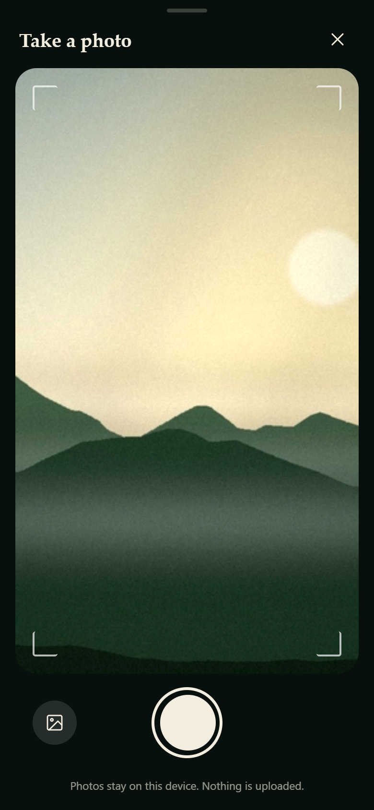
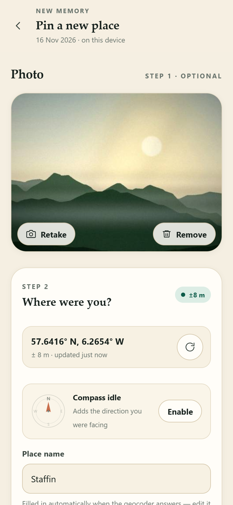
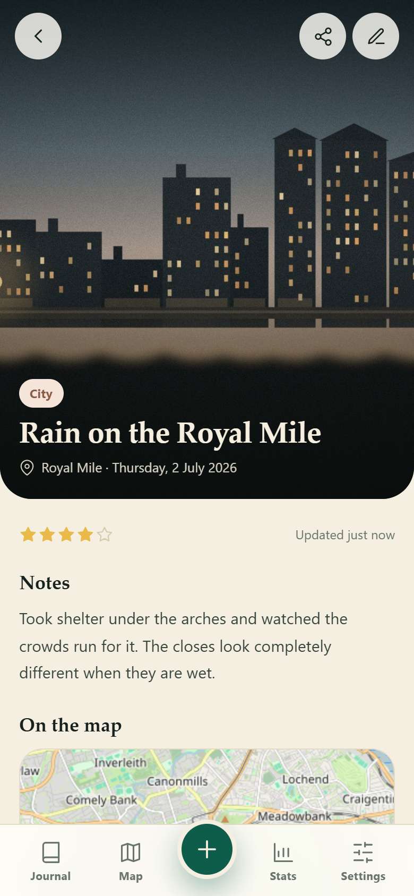
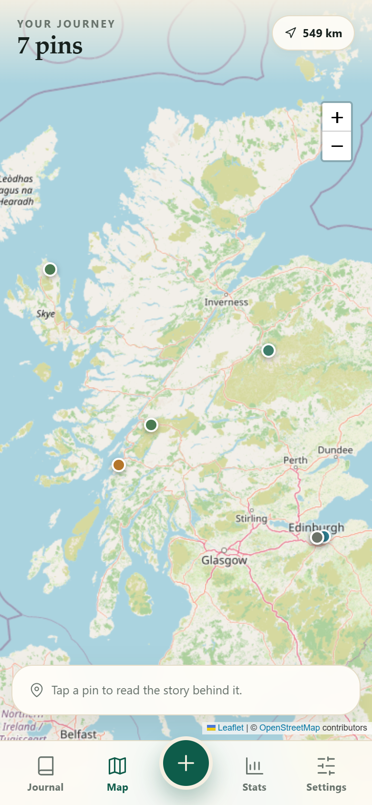
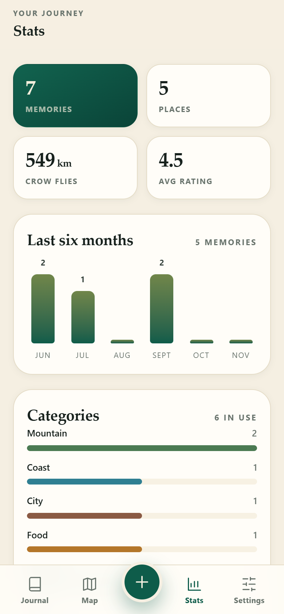
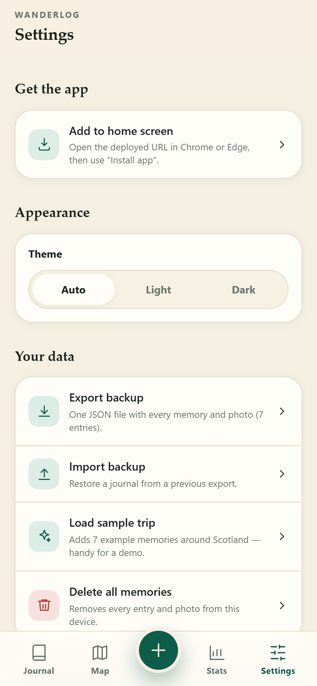

# User guide

This walkthrough covers every screen in Wanderlog and the two checks that matter most for the
coursework: **data survives a restart** and **the app works offline**.

> The screenshots in this guide were captured from the production build at a 390 脳 844 CSS
> viewport (iPhone 13/14 size) with the sample trip loaded.

## 1. Install and first run

### On Android (Chrome / Edge)

1. Open the deployed URL (see [DEPLOYMENT.md](DEPLOYMENT.md)).
2. Tap the browser menu 鈫?**Install app** (or **Add to Home screen**).
3. Launch Wanderlog from the home screen; it opens without a browser bar.

### On iPhone (Safari)

1. Open the URL in **Safari** (Chrome on iOS cannot install PWAs).
2. Tap **Share** 鈫?**Add to Home Screen** 鈫?**Add**.
3. Allow location when prompted on first capture.

### On a desktop browser

The app runs in any Chromium browser or Firefox at the local preview URL. Use the developer tools'
device toolbar to emulate a phone, and use the **Sensors** panel to move the geolocation.

## 2. The journal

- The header summarises the journal: memories, photos and total distance between consecutive
  memories.
- **Search** filters titles, notes, regions and countries as you type.
- **Category chips** filter by type; tap the active chip again to clear it.
- Each card shows the photo, category, rating, place, date and the start of the notes.
- Tapping a card opens the full memory.

With no entries the journal shows an empty state with two actions: **Log a place** and
**Load a sample trip** (seven prepared memories around Scotland).

## 3. Capture a memory

Tap the raised **+** in the bottom bar.

### 3.1 Photo

- Tap the photo slot to open the camera sheet.
- The live preview uses the rear camera. The shutter captures the current frame, then shows a
  preview with **Retake** and **Use photo**.
- The left button opens the photo library; the right button switches cameras when more than one is
  available.
- If camera permission is denied, the sheet explains why and offers **Camera app** (the OS camera)
  and the library picker instead.

### 3.2 Location

- Wanderlog starts a GPS watch as soon as the form opens and keeps refining the fix.
- The pill next to *Where were you?* shows accuracy: green 鈮?30 m, amber 鈮?150 m, red above that.
- The coordinates, accuracy and "updated 鈥? line come straight from the Geolocation API.
- **Compass** shows the direction you are facing. On iOS tap **Enable** once to grant
  `DeviceOrientationEvent` permission.
- The place name is filled automatically from OpenStreetMap/Nominatim. Edit it freely; the region
  and country fields are optional.
- If the network or geocoder is unavailable, the coordinates and a manual name are still saved.

### 3.3 The story

- **Title** (required, 2鈥?0 characters).
- **Notes** (optional, up to 1200 characters, with a live counter).
- **Category** 鈥?coast, mountain, city, food, culture, wildlife or other.
- **Rating** 鈥?tap a star; tap the same star again to clear the rating.
- **Visited on** 鈥?defaults to today and cannot be set in the future.
- **Save memory** writes everything to IndexedDB and opens the new entry.

## 4. Read, update and delete

- The detail page shows the hero photo, category, title, place and date, rating, notes, a map card
  with the exact pin, coordinates and photo dimensions.
- **Share** uses the Web Share API (photo included when supported) or copies the details.
- **Edit** (pencil icon) opens the same form prefilled; saving updates the entry in place and keeps
  `createdAt`.
- **Delete** asks for confirmation, then removes the row and its photos.

### Persistence check (coursework evidence)

1. Create or edit a memory.
2. Close the tab (or force-quit the installed app).
3. Reopen it: the memory is still there, with its photo.

This works because the data lives in IndexedDB, not in memory or session storage.

## 5. Map

- All entries with coordinates are plotted with category-coloured pins.
- Tap a pin: it grows and a card slides up with the photo, title, place and date. Tap the arrow for
  the full entry.
- Pinch to zoom, drag to pan, use the +/鈭?buttons to zoom.
- The pill shows the straight-line distance of the whole trip.
- Map tiles are cached as you browse, so areas you have already viewed still render offline. The
  app shell, photos and data are always available offline.

## 6. Stats

- Memories, distinct places, distance as the crow flies and average rating.
- Six-month activity chart.
- Category distribution.
- Highest-rated memories and the list of regions visited.

## 7. Settings

| Section | What it does |
| --- | --- |
| Get the app | Native install prompt, or iOS instructions when the browser has no prompt |
| Appearance | Auto / Light / Dark, persisted in `localStorage` |
| Export backup | Downloads a single JSON file with every entry and photo (as data URLs) |
| Import backup | Restores a JSON export; regenerates thumbnails and skips invalid rows |
| Load sample trip | Adds the seven demo memories |
| Delete all memories | Clears both IndexedDB stores after confirmation |
| Storage & offline | Connection state, service-worker status, `navigator.storage.estimate()` usage |
| About | Version, stack, map attribution, repository link |

### Offline check (coursework evidence)

1. Open the app once so the service worker installs.
2. Switch the phone to aeroplane mode.
3. Reload: the journal, photos, map (cached area), capture form and saved data all still work.
   Only new place-name lookups and uncached map tiles wait for the network.

## 8. Keyboard and accessibility

- `Tab` moves through every control; focus rings are visible.
- `Esc` closes sheets, dialogs and the camera.
- Chips and stars expose `aria-pressed`; dialogs are `aria-modal`; toasts announce politely.
- The app respects **Reduce Motion** and the OS colour scheme.

## 9. Troubleshooting

| Symptom | Cause | Fix |
| --- | --- | --- |
| "Location permission was denied" | Browser permission blocked | Site settings 鈫?Location 鈫?Allow, then reload |
| Location never resolves | Desktop Wi-Fi positioning disabled, or no GPS fix indoors | Move near a window; in DevTools use Sensors 鈫?Location |
| Camera sheet says permission denied | Camera blocked, or the page is not HTTPS | Allow camera for the origin; use `https://` or `localhost` |
| Camera is black | Another app owns the camera | Close the other app and tap **Try camera again** |
| No install button | Not HTTPS, already installed, or unsupported browser | Deploy over HTTPS; on iOS use Safari's Share menu |
| Place name stays empty | Nominatim unreachable or rate-limited | Type the name; coordinates are still saved |
| Map is blank offline | Tiles for that area were never viewed | Browse the area online once, or accept the blank background |
| Data disappeared | Site data / "clear browsing data" removed IndexedDB | Restore from an exported backup |
